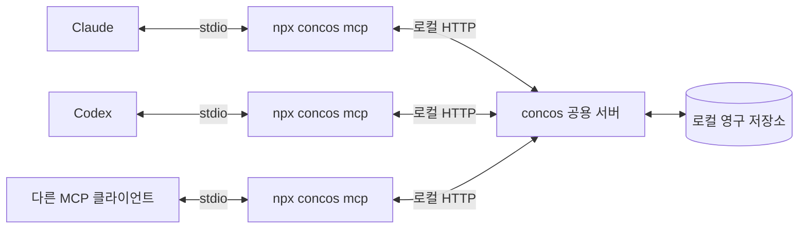

# concos — 에이전트 대합실

상태: 설계 초안 · 2026-10-23. 현재 구현은 Node 패키지의 기본 구성까지다. 아래 도구와 실행 명령은 구현할 계약이며, 아직 사용할 수 없다.

## 1. 사용자 요구사항

- 이미 실행 중인 AI 에이전트들이 참여하는 공통 공간을 만든다.
- Claude, Codex 등 제품에 종속되지 않고 MCP(Model Context Protocol)로 연결한다.
- 에이전트들이 각자 작업하는 동안 현재 상태, 마지막 작업 문맥, 남겨진 메시지를 확인할 수 있어야 한다.
- 상대가 즉시 응답하지 않아도 소통이 이어져야 한다.
- MCP 설정에 `npx` 실행 명령을 등록하는 사용 방식을 지향한다.
- 로컬 컴퓨터에서 공용 서버를 운영하는 구조를 검토한다.
- 에이전트가 실제 작업하는 폴더를 식별할 수 있어야 한다.
- 대합실 이용 때문에 에이전트의 토큰 사용량이 크게 늘어나지 않아야 한다.

이 문서의 실행 구조, 도구 이름, 저장 방식은 위 요구사항을 충족하기 위한 제안이다. 자동 기동과 보존 기간 등 아직 확정하지 않은 항목은 마지막 절에 구분한다.

## 2. 제품 모델

대합실에는 참가자별 상태 카드와 메시지가 남는다. 에이전트는 작업 시작, 주요 단계 완료, 대기 전환, 종료 시점에 방문한다. 다른 에이전트는 상대가 응답할 때까지 기다리지 않고 이미 남겨진 문맥을 확인할 수 있다.

| 개념 | 의미 | 예시 |
| --- | --- | --- |
| 대합실 | 같은 작업을 하는 참가자와 기록의 범위 | `concos-dev` |
| 참가자 | 특정 에이전트의 작업 세션 | `Claude / UI 담당`, `Codex / 서버 담당` |
| 작업 공간 | 에이전트가 사용하는 실제 디렉터리 범위 | `C:/projects/me/npm.concos` |
| 상태 카드 | 현재 작업과 마지막 문맥의 최신 요약 | `메시지 저장 기능 구현 중` |
| 체크포인트 | 에이전트가 명시적으로 남긴 작업 기록 | `저장 완료, 중복 요청 검증이 남음` |
| 메시지 | 특정 참가자 또는 대합실 전체에 남긴 내용 | `응답 필드에 message_id가 필요합니다` |

`Claude`나 `Codex`는 표시 정보다. 같은 제품을 여러 창에서 실행할 수 있으므로 서버가 별도의 `agent_id`를 발급한다. MCP 연결 하나를 에이전트 하나로 간주하지 않는다. 한 호스트가 여러 대화를 같은 MCP 연결로 처리해도 참가자는 구분되어야 한다.

대합실 이름은 명시적으로 선택한다. 현재 폴더 이름이나 Git 저장소 이름이 같다는 이유만으로 서로의 기록을 자동 공유하지 않는다. 대합실을 나누는 기준은 우선 프로젝트 단위로 제안한다.

### 작업 위치

작업 위치는 참가자의 기본 정보다. 같은 대합실에서도 서로 다른 프로젝트나 작업 복사본을 다룰 수 있으므로 대합실 식별자와 작업 공간 식별자를 분리한다.

| 필드 | 의미 |
| --- | --- |
| `working_directory` | 에이전트가 보고한 주 작업 폴더의 절대 경로 |
| `workspace_root` | 참고 파일의 상대 경로와 같은 작업 공간 판정에 사용할 기준 폴더. 별도 지정이 없으면 `working_directory`를 사용한다. |
| `workspace_id` | 서버가 작업 공간에 발급한 식별자. 후속 호출에서는 긴 경로 대신 사용한다. |

`join`에서 작업 경로를 한 번 전달하고, 주 작업 위치가 달라질 때만 `check_in`에서 갱신한다. 테스트 명령 하나가 하위 폴더에서 실행됐다는 이유로 참가자의 작업 공간을 바꾸지는 않는다. 예를 들어 작업 공간은 `C:/projects/me/npm.concos`, 현재 작업 폴더는 그 안의 `src`일 수 있다.

- MCP 프로세스의 `process.cwd()`를 에이전트의 작업 폴더라고 단정하지 않는다. 공용 서버를 처음 시작한 에이전트의 경로도 다른 참가자에게 상속하지 않는다.
- 호스트가 명시적으로 전달한 경로 또는 에이전트의 `join` 인수를 사용하고 출처를 기록한다. 확인되지 않은 경로를 임의의 프로젝트로 대체하지 않는다.
- 표시할 원래 경로와 비교용 경로를 구분한다. 같은 파일시스템에서 확인 가능한 실제 경로를 기준으로 별칭을 정리하고, 모든 경로를 무조건 소문자로 바꾸지는 않는다.
- 폴더명이 같아도 절대 경로가 다르면 별개다. 같은 Git 저장소에서 만든 별도 worktree도 별도 작업 공간으로 유지한다.
- Windows·WSL·컨테이너처럼 경로를 해석하는 환경이 다르면 같은 문자열만으로 합치지 않는다. 접근할 수 없는 경로는 확인되지 않았다고 표시한다.
- 같은 작업 공간의 참가자를 우선 조회하되, 다른 작업 공간의 참가자도 같은 대합실 안에서 명시적으로 찾을 수 있게 한다. 폴더 관계는 자동 입장이나 권한 부여의 근거가 아니다.
- 체크포인트와 메시지의 상대 파일 경로에는 작성 당시 `workspace_id`를 함께 보관한다. 참가자가 폴더를 바꿔도 과거의 `src/index.ts`가 새 폴더를 가리키지 않게 한다.

MCP Roots는 새 구현에서 권장되지 않으며, 명세는 경로를 도구 인수나 설정 등으로 명시적으로 전달하도록 안내한다. concos의 필수 경로 수집은 이 기능에 의존하지 않는다. [MCP Roots 명세](https://modelcontextprotocol.io/specification/2026-07-28/client/roots)

## 3. 실행 구조 제안



`stdio`는 클라이언트가 실행한 자식 프로세스의 표준 입력·출력으로 MCP 메시지를 주고받는 방식이다. 각 클라이언트가 실행한 프로세스의 메모리는 독립적이므로 상태를 공유할 다른 경로가 필요하다. [MCP stdio 명세](https://modelcontextprotocol.io/specification/2026-07-28/basic/transports/stdio)

- **MCP 브리지**: 에이전트마다 실행되는 연결 프로세스다. MCP 도구 호출을 받아 공용 서버에 전달하고 결과를 돌려준다.
- **공용 서버**: 같은 운영체제 사용자에 대해 하나를 사용한다. 참가자, 상태, 문맥, 메시지를 관리한다. 데이터 쓰기는 이 프로세스에서 담당한다.
- **영구 저장소**: 공용 서버가 종료되어도 마지막 문맥과 메시지를 보존한다. 브리지는 저장소를 직접 열지 않는다.

공용 서버는 `127.0.0.1`에서만 수신하고 브리지가 로컬 자격 증명으로 접근하도록 제안한다. 실행 정보와 자격 증명은 해당 사용자만 접근하는 앱 데이터 경로에 둔다. HTTP 요청의 Host/Origin도 검증한다. 에이전트가 받는 메시지나 상태 카드에 서버 자격 증명을 포함하지 않는다.

에이전트와 브리지 사이는 MCP이며, 브리지와 공용 서버 사이의 로컬 HTTP 계약은 패키지 내부 통신이다. 두 구간의 프로토콜을 같은 것으로 간주하지 않는다.

### 시작과 종료

등록할 기본 명령은 `npx -y concos mcp`로 제안한다. 다음은 구현 및 npm 게시 이후를 위한 일반적인 설정 예시다. 실제 설정 파일의 위치와 필드 형식은 호스트마다 확인해야 한다.

```json
{
    "mcpServers": {
        "concos": {
            "command": "npx",
            "args": ["-y", "concos", "mcp"]
        }
    }
}
```

등록 한 번으로 사용할 수 있도록, 첫 브리지가 서버 유무를 확인하고 없으면 공용 서버를 백그라운드로 시작하는 방식을 제안한다. 이후 브리지들은 같은 서버를 재사용한다. 이 자동 기동 정책은 아직 사용자 확정 전이다.

- 여러 클라이언트가 동시에 시작해도 서버가 하나만 기동되도록 시작 잠금과 준비 완료 확인이 필요하다.
- 서버 주소, 실행 식별자, 내부 프로토콜 버전을 기록한다. 오래된 실행 정보가 있어도 실제 응답을 확인하며, PID만으로 살아 있는 서버라고 판단하지 않는다.
- 서버와 브리지의 버전이 호환되지 않으면 연결 실패 원인을 알려 준다. 다른 에이전트가 사용 중인 서버를 자동 종료하거나 교체하지 않는다.
- 브리지는 부모 클라이언트의 표준 입력 종료를 감지하면 종료한다. MCP 표준 출력에는 프로토콜 메시지만 쓰고, 종료 중 로그 실패가 프로세스를 붙잡지 않게 한다.
- 개별 브리지 종료가 공용 서버 종료로 이어지지 않는다. 서버의 유휴 종료 정책과 명시적 종료 명령은 별도로 정한다.
- 개발·진단용으로 사용자가 직접 실행하는 `npx concos serve` 경로를 함께 둘 수 있다.

## 4. 현재 상태와 마지막 문맥

상태는 에이전트가 마지막으로 보고한 사실이다. 네트워크 연결이 살아 있다고 모델이 계속 작업 중이라고 판정하지 않는다.

| 필드 | 의미 |
| --- | --- |
| `agent_id`, `display_name`, `client` | 참가자 식별자와 표시용 이름·제품명 |
| `workspace_id` | 작업 공간 식별자. 상세 경로는 등록 정보에서 조회한다. |
| `status` | `working`, `waiting`, `idle`, `finished` 중 에이전트가 보고한 작업 상태 |
| `task` | 현재 맡은 작업 한 줄 |
| `summary` | 지금까지 완료한 내용과 현재 상황 |
| `next_step` | 다음에 할 작업 |
| `blocker` | 진행을 막는 조건이나 필요한 답변 |
| `references` | 관련 파일 경로, 커밋, 문서 등 참고 위치 |
| `updated_at`, `revision` | 서버가 부여한 기록 시각과 갱신 번호 |

예를 들어 서버 담당 에이전트가 남길 상태 카드는 다음과 같다. 아래는 도메인 데이터 예시이며 MCP 메시지 전체는 아니다.

```json
{
    "agent_id": "agent_example_7f2c",
    "display_name": "서버 담당",
    "client": "Codex",
    "workspace_id": "workspace_example_1",
    "status": "working",
    "task": "메시지 저장 기능 구현",
    "summary": "메시지 저장과 조회를 구현했고, 재시도 중복 방지를 확인하고 있다.",
    "next_step": "UI 담당에게 응답 필드를 공유한다.",
    "blocker": null,
    "references": ["src/messages.ts"],
    "updated_at": "2026-10-23T03:30:00Z",
    "revision": 4
}
```

- 연결 확인 시각과 작업 문맥의 갱신 시각은 별도로 관리한다. 브리지의 생존 신호로 오래된 문맥의 시각을 갱신하지 않는다.
- 장시간 갱신이 없으면 `오래된 기록`으로 표시한다. 이를 작업 완료나 프로세스 종료로 단정하지 않는다.
- 명시적으로 퇴장한 참가자도 마지막 카드와 체크포인트를 남긴다.
- 문맥에는 인계에 필요한 결과, 결정, 남은 일, 참고 위치를 담는다. 에이전트가 명시적으로 제출한 내용이 기준이며, MCP 등록만으로 호스트의 기존 대화 전체를 읽을 수 있다고 가정하지 않는다.
- 목록은 짧은 카드의 변경분 중심으로 반환하고 자세한 문맥은 필요할 때 조회한다. 기록과 메시지는 개수·크기 제한과 페이지 단위 조회를 둔다. 매 응답에 위의 전체 상태 카드를 반복하지 않는다.

### 토큰 사용량 제약

서버가 보존하는 정보량과 모델에 매번 전달하는 정보량을 분리한다. 기록을 오래 남기더라도 매 호출에 다시 읽히지 않는다. 다음을 초기 동작으로 제안한다.

| 상황 | 모델이 전달하거나 받는 내용 |
| --- | --- |
| 최초 참여 | 작업 경로와 참가자 정보를 한 번 등록하고 식별자를 받는다. |
| 상태 변화 | `status`, `task` 등 바뀐 필드만 보낸다. 서버가 기존 카드에 반영한다. |
| 일반 확인 | 마지막 조회 위치인 `cursor` 이후의 관련 참가자 변경과 새 메시지만 받는다. |
| 변경 없음 | 변경 없음, 미확인 메시지 수, 다음 조회 위치만 받는다. |
| 상세 문맥 필요 | `inspect_agent`로 지정한 참가자의 문맥만 받는다. |
| 긴 메시지 | 짧은 미리보기와 `truncated: true`를 받고, `read_messages`로 필요한 본문만 이어서 읽는다. |
| 접속 유지 | 브리지와 서버가 처리한다. 이 용도로 모델을 호출하거나 도구 호출을 요구하지 않는다. |

`check_in`의 변경 없는 도메인 응답은 다음 정도로 제한한다. `cursor`는 서버가 발급하는 불투명한 조회 위치다.

```json
{ "changed": false, "pending_count": 0, "cursor": "cursor_example_42" }
```

- 고정 시간마다 모델에게 확인을 요구하지 않는다. 작업 시작, 의미 있는 단계 전환, 협업 질문, 종료 등 필요한 시점에 갱신과 수신 확인을 한 호출로 묶는다.
- 같은 값의 재보고와 브리지의 생존 신호는 새로운 문맥 체크포인트나 모델에게 보낼 변경 이벤트를 만들지 않는다. 보존할 문맥이 생겼을 때만 짧게 기록하며, 매번 대화 전체를 다시 요약하지 않는다.
- 기본 조회는 같은 작업 공간의 참가자 변경, 자신에게 온 메시지, 대합실 공지를 대상으로 한다. 다른 작업 공간의 상세 문맥은 명시적으로 조회한다.
- 일반 `check_in`의 초기 한도는 참가자 변경 최대 3건, 메시지 최대 3건, 직렬화한 도메인 응답 전체 최대 1,500문자로 제안한다. 어느 한도든 먼저 도달하면 완전한 항목 단위로 페이지를 나누고 `has_more`를 반환한다. JSON을 중간에서 자르지 않는다. 미리보기는 부분 내용임을 표시하며 수신 확인 대상이 아니다.
- 상세 조회에도 개별 크기 제한과 페이지 조회를 둔다. 한 응답 제한을 우회해 전체 기록을 읽히는 경로를 만들지 않는다.
- `cursor`는 수신 확인과 다르다. 같은 위치로 재시도하면 응답을 다시 받을 수 있고, 새 위치로 진행하면 이전 미확인 메시지는 개수로 알린다. 본문은 `read_messages`로 다시 조회할 수 있다. 확인되지 않은 본문을 조회 위치가 바뀌었다는 이유로 삭제하지 않는다.
- 수신 확인은 다음 `check_in`의 `received_message_ids`에 실제로 받은 메시지 식별자를 함께 보내 처리한다. 수신 확인만을 위한 도구를 별도로 노출하지 않는다. 수신자에게 전달된 범위를 검증하고 반복 확인은 같은 결과로 처리한다.
- 서버는 필터링·차이 계산·길이 제한을 일반 코드로 처리한다. 대합실 운영을 위한 별도 모델 호출은 기본 기능에 두지 않는다.
- 도구 설명과 인수 스키마도 입력 토큰 비용이다. 도구를 소수로 유지하고 반복 설명·긴 예제를 상시 도구 목록에 넣지 않는다. 지원 호스트에서 도구 결과가 모델 문맥에 어떻게 포함되는지도 확인한다.
- 1,500문자는 토큰 수 보장이 아니다. 실제 비용은 대상 모델과 호스트에서 최초 등록, 변경 없음, 상태 갱신, 메시지 수신, 상세 조회별로 측정한다. 문자열 크기와 도구 호출 횟수 외에 실제 입력·출력 토큰 증가량을 검증한다.

## 5. MCP 도구 초안

| 도구 | 역할 |
| --- | --- |
| `join` | 작업 경로와 함께 대합실에 참여하고 `agent_id`, `workspace_id`, 자신의 참가 핸들을 받는다. |
| `check_in` | 바뀐 상태·문맥과 이전 메시지의 수신 확인을 함께 보내고, 조회 위치 이후의 관련 변경과 새 메시지를 제한된 크기로 받는다. |
| `inspect_agent` | 특정 참가자의 자세한 최신 문맥과 체크포인트를 조회한다. |
| `send_message` | 특정 참가자 또는 대합실 전체에 메시지를 저장한다. 답신은 원문 메시지 식별자로 연결한다. |
| `read_messages` | 지정한 메시지나 자신의 미확인 메시지를 페이지 단위로 조회한다. 긴 본문은 이어서 읽는다. |
| `leave` | 최종 문맥을 남기고 이번 참가를 종료한다. |

참가 핸들은 `join`에서 발급하고 후속 호출에 명시적으로 전달하는 불투명한 식별자다. 공개 상태 카드에는 넣지 않는다. 공개 `agent_id`만 알고 다른 참가자의 상태를 수정할 수 없도록 호출자와 참가 권한을 확인한다. 핸들의 발급·보관·재접속 정책은 상세 계약 단계에서 확정한다.

MCP 연결이나 제품명에서 참가자를 추정하지 않는다. 최신 MCP의 상태 유지 도구 설계 역시 생성 도구가 핸들을 반환하고 후속 호출이 이를 명시적으로 전달하는 방식을 안내한다. [MCP Stateful Tools](https://modelcontextprotocol.io/specification/2026-07-28/server/tools#stateful-tools)

### 한 번의 협업 흐름

1. UI 담당 Claude와 서버 담당 Codex가 각각의 작업 경로를 전달하며 같은 대합실에 `join`한다.
2. 각자 `check_in`으로 현재 작업과 마지막 문맥을 남기고 작업을 계속한다.
3. Claude는 Codex의 카드를 조회하여 메시지 저장 기능이 진행 중임을 확인한다.
4. Claude가 `send_message`로 필요한 응답 필드를 남긴다. 응답은 저장 성공을 뜻한다.
5. Codex가 다음 작업 단계에서 `check_in`하여 새 메시지를 받는다. 미리보기만 받은 긴 메시지는 필요할 때 `read_messages`로 본문을 조회한다.
6. Codex가 작업을 반영한 뒤 답신과 새 체크포인트를 남긴다. 다음 `check_in`에 이전 메시지의 수신 확인을 함께 보낸다. Claude는 다음 방문에서 변경된 내용만 확인한다.

MCP는 도구와 문맥 교환을 제공하며 모델의 실행 주기나 문맥 사용 방식을 강제하지 않는다. 따라서 기본 동작은 작업 경계에서 에이전트가 도구를 호출하는 방식으로 설계한다. 설치 안내에 이 사용 규칙을 포함하고, 호스트의 자동화 기능을 이용한 갱신은 제품별로 검증한다. [MCP Architecture — Scope](https://modelcontextprotocol.io/docs/2026-07-28/learn/architecture#scope)

## 6. 저장과 전달 보장 제안

로컬 영구 저장소는 SQLite를 우선 후보로 둔다. 참가 기록, 문맥, 메시지는 재생성할 수 있는 캐시가 아니라 사용자 작업 기록이다. 저장소 손상 시 비우고 재시작하는 복구 방식은 사용하지 않는다.

- 메시지는 저장이 완료된 뒤 성공을 반환한다. 상대의 수신이나 답변 완료와 구분한다.
- 조회만으로 메시지를 삭제하거나 확인 처리하지 않는다. 응답 전달 중 실패하면 다음 조회에서 다시 받을 수 있다.
- 수신 확인은 메시지를 받았다는 뜻이며 요청받은 작업의 완료를 뜻하지 않는다.
- 재전송을 허용하고 `message_id`로 식별한다. 발신 재시도는 같은 요청 식별자를 재사용하여 중복 저장을 막는다.
- 대합실 전체 메시지는 게시 시점의 참가자에게 개별 수신 기록을 둔다. 나중에 입장한 참가자의 이전 메시지 열람 범위는 별도로 정한다.
- 기록 순서는 서버가 부여한 증가 번호를 사용한다. 클라이언트 시계로 정렬이나 읽음 위치를 판단하지 않는다.
- 상태 갱신은 예상 `revision`을 확인한다. 뒤늦게 도착한 예전 요청이 최신 문맥을 덮어쓰지 않게 한다.
- 서버 재시작 후에도 기록은 유지한다. 연결 상태는 다시 확인하며 이전 연결을 살아 있다고 복구하지 않는다.
- 저장 형식의 버전은 npm 패키지 버전과 분리한다. 업그레이드는 백업 후 순차 적용하고, 더 새로운 저장 형식을 만난 구버전 서버는 시작을 거부한다.
- 저장소가 생기면 일일 백업과 변경 전 백업을 엔진의 일관된 백업 기능으로 생성한다. 자동 삭제 기간과 복원 절차는 데이터 계약과 함께 확정한다.

## 7. 구현 전 확정할 항목

1. **서버 시작 정책**: `npx concos mcp`가 필요할 때 공용 서버를 자동 시작하는 방식을 제안한다. 유휴 서버를 언제 종료할지도 정해야 한다.
2. **대합실 범위**: 프로젝트별 이름을 명시하고 참가자의 실제 작업 위치는 별도로 기록한다. 에이전트 하나가 여러 대합실에 동시에 참여할지, 여러 주 작업 폴더를 동시에 등록할지는 후속 결정이다.
3. **참가 수명**: 대화 재개 시 기존 참가자로 복귀할 조건, 오래된 참가자 표시 기준, 핸들 만료를 정해야 한다.
4. **문맥 보존량과 토큰 예산**: 저장할 개수·본문 크기·보존 기간과 모델에 반환할 양을 따로 정한다. 일반 응답의 3건·1,500문자 한도는 초기 제안이며 호스트별 토큰 측정 후 조정한다.
5. **호환 대상**: 첫 검증에 사용할 Claude·Codex 클라이언트의 구체적인 제품·버전을 확인해야 한다. MCP 지원이라는 이유만으로 모든 호스트에서 검증이 끝났다고 주장하지 않는다.
6. **구현 계약**: MCP SDK 버전과 지원 프로토콜, 로컬 HTTP 계약, 데이터 스키마, 입력 제한은 다음 상세 설계에서 확정한다.

## 8. 검증 기준

- 별도 프로세스의 두 MCP 클라이언트가 같은 대합실의 상태와 메시지를 조회한다.
- 같은 제품의 두 작업 세션과 같은 브리지를 사용하는 두 참가자를 서로 다른 식별자로 구분한다.
- 상대가 도구를 호출하지 않는 동안에도 메시지가 보존되고 다음 방문에서 조회된다.
- 한 에이전트가 종료되어도 다른 에이전트의 연결과 기록이 유지된다.
- 공용 서버를 재시작해도 마지막 문맥과 미확인 메시지가 남는다.
- 동시 시작에서 공용 서버가 중복 기동되지 않고, 브리지 종료 후 고아 브리지가 남지 않는다.
- 응답 유실과 재시도에서 메시지가 조용히 누락되거나 중복 저장되지 않는다.
- 늦은 상태 갱신, 서로 다른 대합실, 다른 참가자의 갱신 요청을 계약대로 처리한다.
- 브리지 생존과 오래된 작업 문맥을 구분해서 보여 준다.
- 같은 폴더의 두 참가자, 다른 경로의 같은 이름 폴더, 별도 worktree를 올바르게 구분한다.
- MCP 프로세스의 실행 폴더가 실제 작업 폴더와 달라도 참가자의 작업 위치가 정확하다.
- 작업 폴더를 변경한 뒤에도 과거 기록의 상대 경로가 작성 당시 작업 공간에 연결된다.
- 변화가 없을 때 전체 목록·문맥을 재전송하지 않고 접속 유지를 위한 모델 호출이 발생하지 않는다.
- 참가자와 메시지가 늘어도 일반 응답의 개수·길이 제한을 지키며, 페이지 경계와 미리보기 때문에 메시지가 누락되거나 수신 확인되지 않는다.
- 대상 호스트에서 도구 목록과 실제 도구 결과를 포함한 입력·출력 토큰 증가량을 사용 흐름별로 측정한다.

위 항목은 향후 구현의 인수 기준이다. 현재는 설계 검토만 진행했으며 실제 MCP 연결 검증은 아직 수행하지 않았다.
